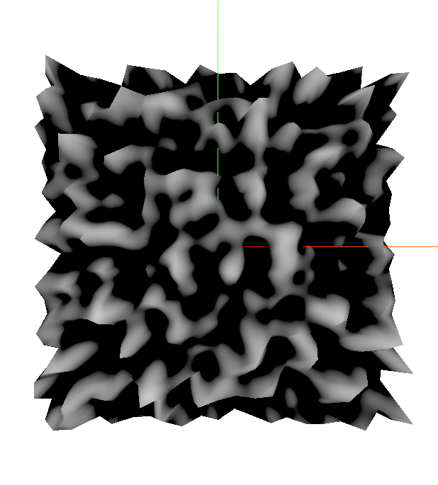
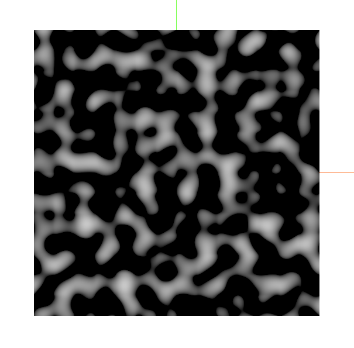

## Aprendiendo Shaders por Primera vez Utilizando ThreeJS y TSL.

Este repositorio es básicamente un libro de apuntes que describe hasta hoy, el proceso de mi aprendizaje de shaders, así como 
el proceso de mapeo 2D-3D 'Ray Casting', y el recordar conceptos matemáticos de vectores y funciones matemáticas para su 
utilización en el mismo.

El objetivo semi-final que logré, fue generar una función de 'Perlin Noise', que la requiero para utilizarla en un proyecto futuro. 
Se incluyen funciones descartadas que resultaron ser aproximaciones visuales que no tenían nada que ver con el algoritmo real del 
Ruido de Perlin, y que me quitaron demasiado tiempo. XD

---

---

_Jhz - 'RoadToPF'_