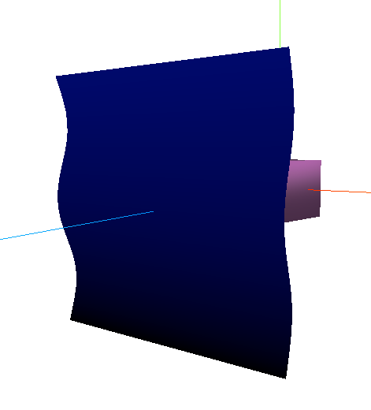
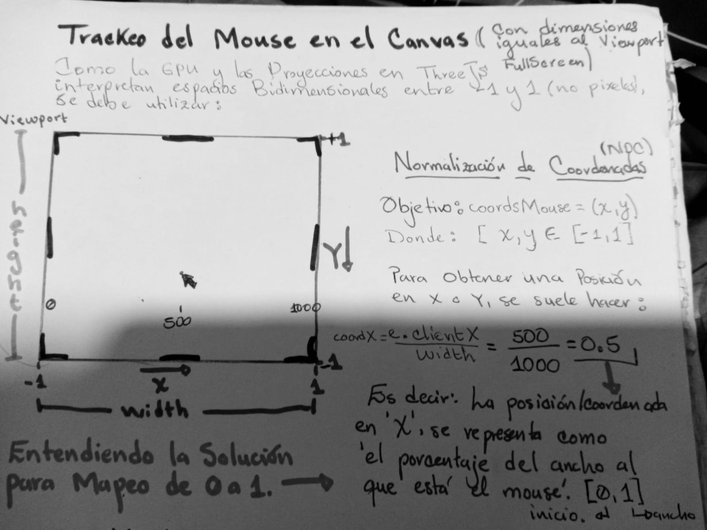
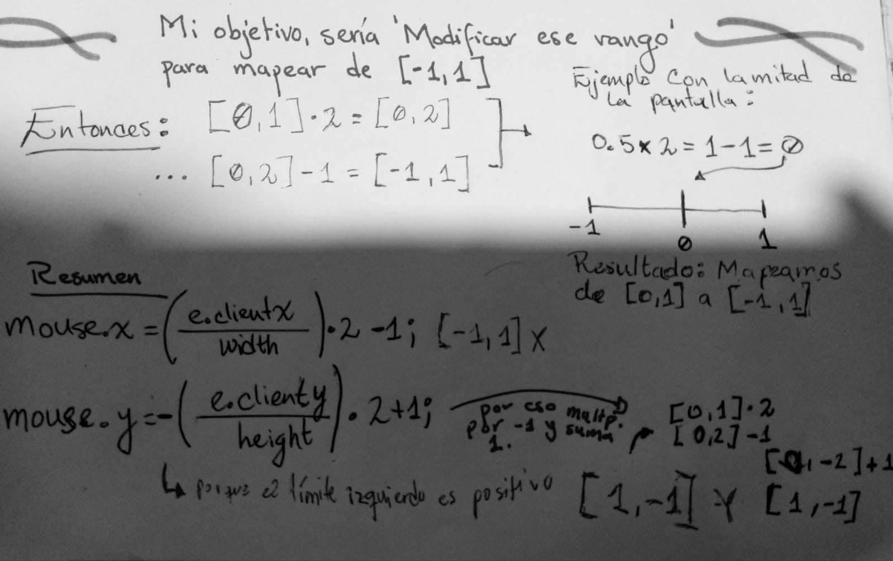
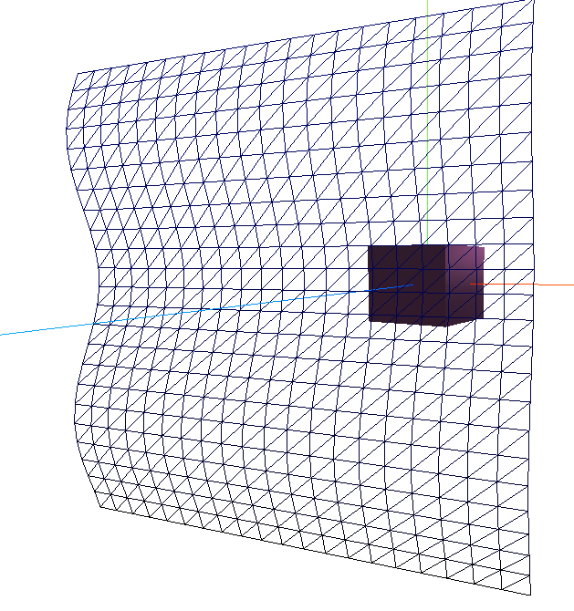
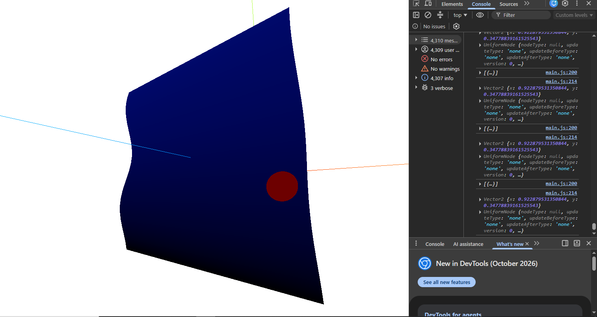

# Pensando la Lógica Detrás del Plano

Luego de experimentar con las propiedades _colorNode_ y _positionNode_ tanto del plano como el cubo, procedo a pensar cómo colorear independientemente los vértices del plano.

Primeramente, se me ocurre algo similar a la aproximación del desfase hecho en la onda.
Podría pintar los vértices del plano de más a menos brillo según el mapeo UV. Luego de estudiar este comportamiento, podría intentar trackear la posición del mouse y hacer que de alguna forma, los vértices reaccionen al evento hover.



```js
const colorUniformePlano = uniform( new THREE.Color(0x0000ff) );
materialPlano.colorNode = colorUniformePlano;
// Así se accede al color/valor que almaena el UNIFORM
console.log(colorUniformePlano.value);

// Modificando el brillo mediante mapeo UV
materialPlano.colorNode = uv().y.mul(colorUniformePlano);
/* En este caso, no reasigné el valor del uniform, porque lo que requería era variar el brillo, no cambiar el color.*/
```

## Trackeo del Mouse y Mapeo de [0, 1] a [-1, 1]

Continuando, estudié el trackeo de posición del mouse con respecto al viewport por sencillez. (Es decir, los casos en los que el canvas tiene el mismo ancho que la UI interna del navegador, ya que si el canvas tiene menos ancho, lo que cambia es cierta parte de las ecuaciones)





Esto me llevó a pensar que, por más que yo clickee en un plano 2D, que es la página web, la proyección de ese 'click/coordenadas'(NDC: Normalized Device Coordinates) en el espacio 3D de ThreeJS no tendría una equivalencia del todo compatible.

Entonces, **Para saber si un click coincide con la posición de un Objeto 3D en ThreeJS, se puede utilizar el método de _Ray Casting_.**

## Ray Casting

Este método permite solucionar varios problemas computacionales, entre ellos, el de mi interés, que es determinar los objetos en el espacio 3D con los que las coordenadas del mouse coinciden.

Este método se basa en trazar una línea recta invisible en el espacio (3D), 'disparada' desde la posición del mouse ([-1, 1]) hacia el fondo de la Escena 3D (el objeto Scene). De modo que, en este caso, ThreeJS o el motor de renderizado calculará qué polígonos u objetos atraviesa el rayo, retornando el punto (X, Y, Z) exacto de colisión en coordenadas 3D.

Es decir, el estudio del mapeo de coordenadas del viewport [0, 1] a coordenadas que entiende la GPU [-1, 1], no fue en vano; es de gran utilidad, ya que esta coordenada será utilizada al ejecutar este método.

```js
//Para esto, se requiere haber calculado las NDC (normalized device coordinates [-1, 1])
const raycaster = new THREE.Raycaster();

// Dentro de un ciclo, por cada frame, se emite un rayo desde la posición de la cámara, en la dirección que apunten las coordenadas del mouse (NDC).
raycaster.setFromCamera(mouse, camera);

// Luego, se verifica si hubieron puntos de intersección con el objeto deseado.
const intersecciones = raycaster.intersectObject(meshPlano); // Recibe como parámetro el objeto 3D a detectar, y retorna un array de los puntos de intersección (3DVec), el mapeo UV (u,v), etc. Donde el primer elemento es el punto intersecto más cercano al origen del rayo.

if (intersecciones.length > 0) {
    // Obtener el primer punto de intersección (para este caso), que es el primer elemento
    const puntoChoque = intersecciones[0].point; // 3D coords relativas al espacio
    const parteChoque = intersecciones[0].uv; // 2D coords relativas al objeto

    //console.log(`PuntoChoque: XYZ(${puntoChoque.x}, ${puntoChoque.y}, ${puntoChoque.z}`);
    console.log(parteChoque);

}
```

### ¿Y si quiero cambiar el color del 'vértice' que impacta al plano?

_Un plano, y la gran mayoría de geometrías en ThreeJS están constituídas por triángulos._ 
Cuando un rayo intersecta al plano, la mayoría de veces no será un intersecto exacto con un vértice del plano, sino con uno los triángulos (caras) que lo conforman. Esto se puede intuír observando el wireframe de alguna geometría, como el siguiente plano de la imagen.



Entonces, **¿qué hacer para cambiar el color del vértice, si lo que suele intersectar es un triángulo?** 

Según la teoría que retorna Gemini IA: _'Cuando el RayCaster impacta sobre un triángulo, no busca el vértice más cercano; calcula matemáticamente la coordenada exacta del impacto dentro de la superficie del polígono usando **coordenadas baricéntricas**, retornando las coordenadas en 3D y 2D'. Cuando este punto de impacto se utiliza en un shader de TSL, la GPU se encarga de la **interpolación**. El material evaluará la distancia de cada pixel de la pantalla contra ese punto de impacto. De modo que el degradado o color reaccionará píxel por píxel, independientemente de los vértices del plano._

**Resumen:** Para lograr esto, se definió una distancia mínima que debe de haber entre el _pixel pintado actualmente_ y el _pixel del objeto que tocó el mouse (ray casting)_. Tomando en cuenta que en TSL, _uv()_ representa el pixel **actual** pintado en pantalla.

Luego, por cada frame se actualiza un _'uniforme'_ que contiene la posición actual del ray casting (o la coordenada donde el mouse tocó al plano). Este uniforme se utiliza en un shader que realiza un operador condicional ternario de TSL (_select_), comprando la distancia entre el pixel actual procesado por la GPU (_uv()_), y el pixel clickeado del plano en su forma de mapa UV. Si esta distancia es menor(o mayor, según condiciones deseadas), se pintarán los pixeles alrededor de esa distancia de otro color.

```js
//Código real en cascada:

// Esto, para demostrar que no necesariamente se pueden seguir pintando los píxeles de un solo color, sino en base a otro shader. :)
const colorUniformePlano = uniform( new THREE.Color(0x0000ff) );
const shaderBrilloUV = uv().y.mul(colorUniformePlano);

// RAYCAST (Se actualiza en cada frame, ya que hay que verificar constantemente si el mouse(rayo) intersecta a un objeto)
const raycaster = new THREE.Raycaster();

// Rastrear coordenada uv de impacto, actualizada desde el loop
const uvMouseUniformChoque = uniform( new THREE.Vector2() );

// 'Si la distancia del punto procesado al punto del mouse en hover es menor que [...], colorear'
const condicionPintar = distance( uv(), uvMouseUniformChoque ).lessThanEqual(0.05);

// Utilizando un condicional ternario de TSL (el IF/ELSE es más complicado en estructura)
materialPlano.colorNode = select( condicionPintar, color(0xff0000), shaderBrilloUV);

/* Del lado del AnimationLoop */
const parteChoque = intersecciones[0].uv;

// Actualizar uniforme para que almacene el punto del plano donde se colocó el cursor
uvMouseUniformChoque.value.copy(parteChoque);
```

Esto deja cosas por hacer, como evitar que el color se quede en la última posición en la que se hizo hover, o posiblemente evitar que alguna parte del plano inicie 'coloreada' al recargar la página, sin embargo, son correcciones menores, como el uso de condicional cuando no se está intersectando el plano, o inicializar los vectores en coordenadas cuya dirección no permita que el rayo intersecte al plano. :D



---

Jhz - Process - 2026